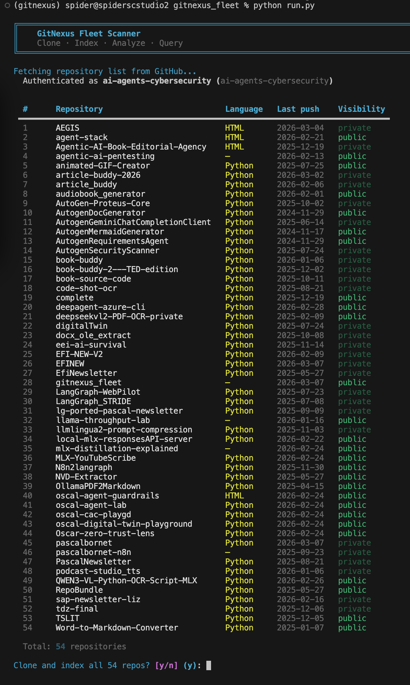
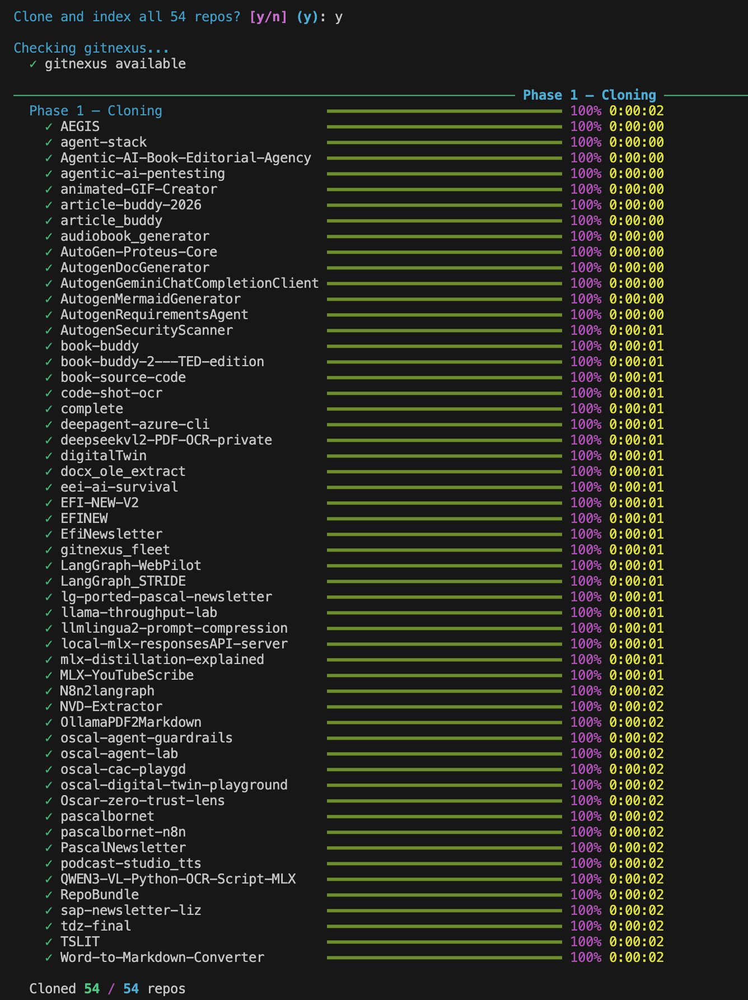
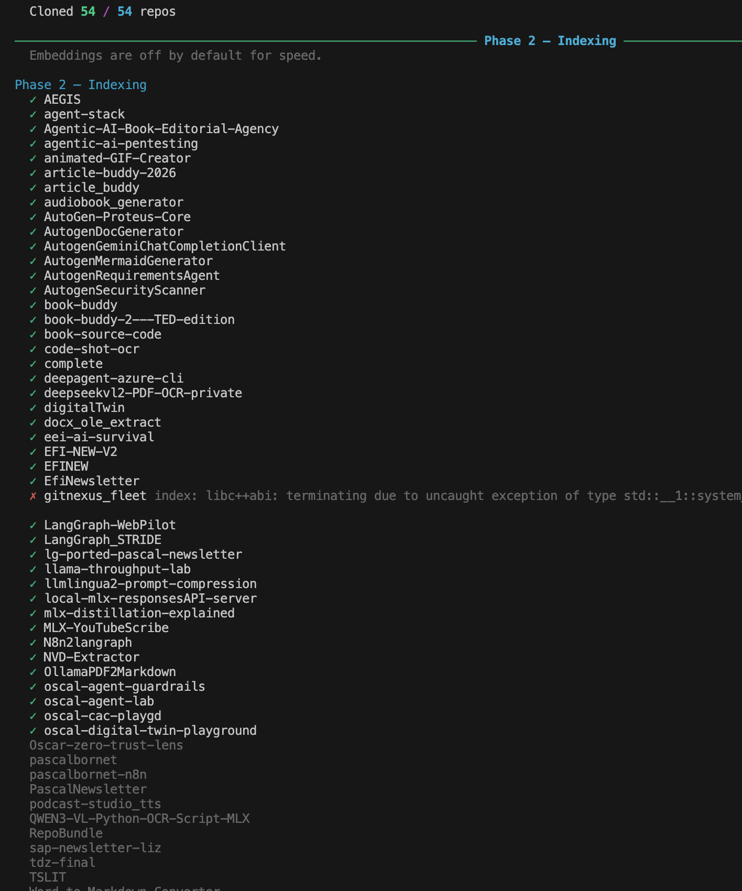
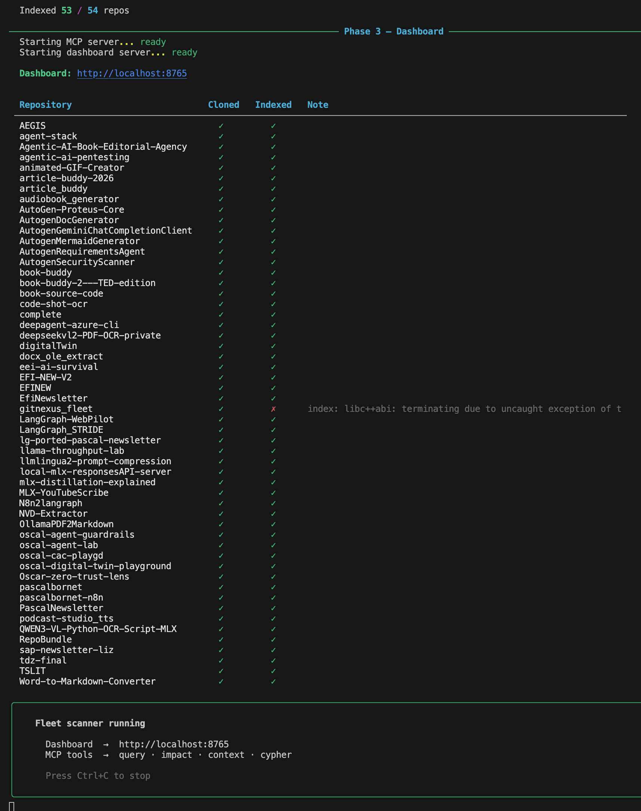
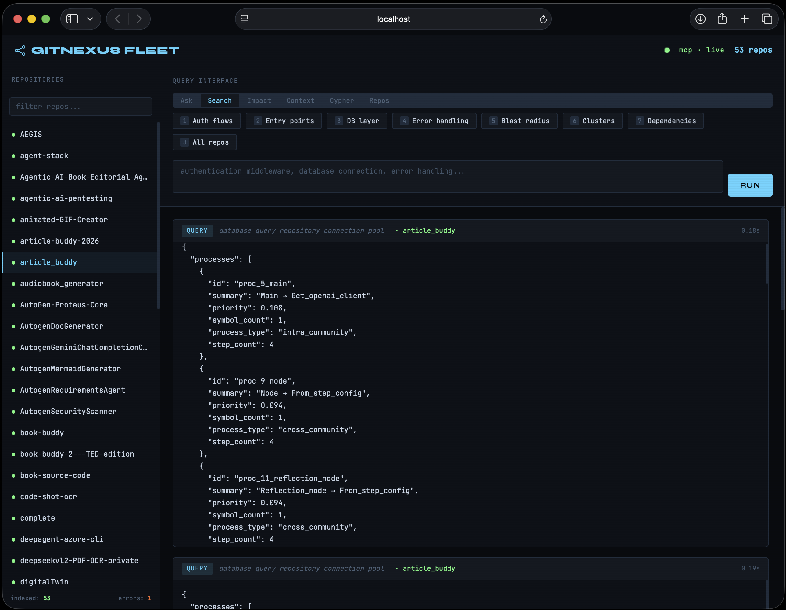

# GitNexus Fleet

    -purple)   

GitNexus Fleet is a local runner script designed to aggressively clone down your entire GitHub repository fleet, automatically index all repositories with [GitNexus](https://github.com/abhigyanpatwari/GitNexus), and start up an MCP server and Web UI dashboard so you can query, analyze, and gain an AI understanding of your source code context locally.

## Screenshots

<table>
<tr>
<td width="50%">
<strong>Repo Discovery & Authentication</strong><br>

</td>
<td width="50%">
<strong>Phase 1 — Parallel Cloning</strong><br>

</td>
</tr>
<tr>
<td width="50%">
<strong>Phase 2 — Indexing with GitNexus</strong><br>

</td>
<td width="50%">
<strong>Phase 3 — MCP Server & Dashboard Ready</strong><br>

</td>
</tr>
<tr>
<td colspan="2">
<strong>Web UI — Query Your Entire Fleet</strong><br>

</td>
</tr>
</table>

## How It Works

```
  ┌─────────────┐
  │  GitHub API  │
  └──────┬──────┘
         │  fetch repo list
         ▼
  ┌─────────────┐     ┌──────────────────────────────────────┐
  │  Phase 1:   │     │  ~/.gitnexus_fleet/repos/            │
  │  Clone      ├────▶│    ├── repo-1/                       │
  │  (5 workers)│     │    ├── repo-2/                       │
  └──────┬──────┘     │    └── repo-n/                       │
         │            └──────────────────────────────────────┘
         ▼
  ┌─────────────┐     ┌──────────────────────────────────────┐
  │  Phase 2:   │     │  Each repo gets a .gitnexus/ dir     │
  │  Index      ├────▶│  containing a KuzuDB graph database  │
  │  (3 workers)│     │  with functions, classes, files,     │
  └──────┬──────┘     │  calls, imports, and communities     │
         │            └──────────────────────────────────────┘
         ▼
  ┌─────────────┐        ┌───────────────┐
  │  Phase 3:   │  stdio │  gitnexus     │
  │  MCP Server ├───────▶│  mcp process  │
  └──────┬──────┘        └───────┬───────┘
         │                       │ reads .gitnexus/ dirs
         ▼                       ▼
  ┌─────────────┐     ┌──────────────────────────────────────┐
  │  Dashboard  │     │  query · impact · context · cypher   │
  │  :8765      │◀───▶│  (MCP tools over JSON-RPC)           │
  └─────────────┘     └──────────────────────────────────────┘
         ▲
         │
    Browser / LLM
```

## File Structure

```text
gitnexus_fleet/
├── run.py                    # Entry point: python run.py
├── gitnexus_fleet/           # Python package
│   ├── __init__.py           # Auto-installs missing dependencies
│   ├── __main__.py           # Allows: python -m gitnexus_fleet
│   ├── config.py             # Constants and shared console
│   ├── github.py             # GitHub API client
│   ├── mcp.py                # MCP stdio client for gitnexus
│   ├── repos.py              # Clone/index logic and status tracking
│   ├── server.py             # HTTP dashboard server
│   ├── cli.py                # Rich TUI and main orchestration
│   └── static/
│       └── dashboard.html    # Web UI dashboard
├── requirements.txt          # Python dependencies (rich, requests, python-dotenv)
├── QUICKSTART.md             # Explains basic GitNexus usage options
└── .env.gitnexus             # Standardized ENV file for your API credentials
```

### Generated Directories (At Runtime)
When the fleet scanner runs, it automatically manages a completely local index and store:

```text
~/.gitnexus_fleet/repos/                   # Cloned directories live here
    ├── <repository-name-1>/
    │   └── .gitnexus/                     # Local KuzuDB database generated by running 'gitnexus analyze'
    └── <repository-name-2>/
        └── .gitnexus/                     # The index, properties, edges, and embeddings for repo 2
```

## Setup & Configuration

Instead of dealing with inline exports each time, the orchestrator script natively supports `.env.gitnexus`. 

Create `.env.gitnexus` in your working directory and provide it:
```dotenv
GITHUB_TOKEN=ghp_your_github_token_here

# (Optional) Provide OpenAI key if you want to use cloud-based text-embedding-3
# Note: Requires manual script modification to run `analyze --embeddings` if desired.
OPENAI_API_KEY=sk-your_openai_key_here
```

Then simply install requirements and start the orchestrator:
```bash
pip install -r requirements.txt
python run.py
# Or: python -m gitnexus_fleet
```

## How the Database Works

GitNexus doesn't use a background daemon or cloud storage for your code infrastructure. 
Instead, it utilizes **KuzuDB** (a highly optimized Embedded Graph Database).

When the `gitnexus_fleet.py` script runs `gitnexus analyze` against your repositories, it generates the graph database directly into a `.gitnexus/` hidden folder at the root of that repository. 

This means your database lives at:
`~/.gitnexus_fleet/repos/<repository-name>/.gitnexus/`

When you query the Web UI or connect an LLM via the MCP server, it simply points to those local `.gitnexus/` directories and reads the graph data directly. 

## Embedding Models 

When creating embeddings for semantic search capabilities, GitNexus relies on the `transformers.js` package to run embedding logic natively without leaving your machine. By default it uses `Snowflake/snowflake-arctic-embed-xs` using your local CPU or WebGPU setup.

If you desire State-of-the-Art (SOTA) embedding quality, you can export `OPENAI_API_KEY` (or place it in your `.env.gitnexus`). GitNexus will dynamically detect it and offload embedding generation to OpenAI's robust cloud offering instead.

## Acknowledgments

This project is built on top of [GitNexus](https://github.com/abhigyanpatwari/GitNexus) by Abhigyan Patwari — the indexing engine, KuzuDB graph database, and MCP server that power all code analysis features.

## License

This project is licensed under the Apache License 2.0 — see the [LICENSE](LICENSE) file for details.

---

Built by [Nic Cravino](https://github.com/ai-agents-cybersecurity/)

[](https://books.apple.com/us/book/ai-agents-in-cybersecurity/id6751737181)
